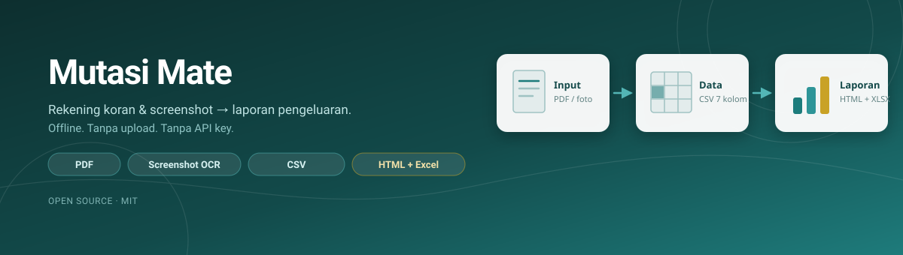
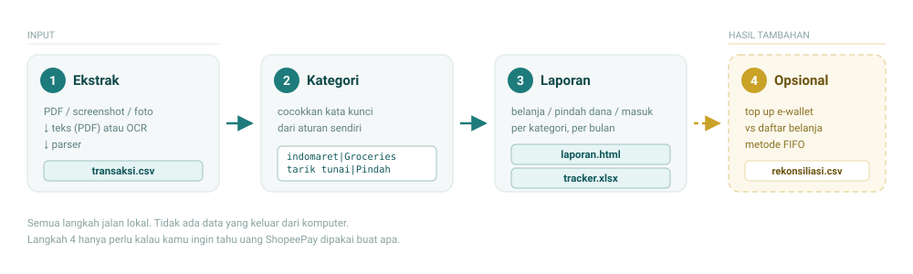

<p align="center">
  
</p>

<h3 align="center">Turn bank statements, receipt screenshots, and Shopee orders into a real spending report.</h3>

<p align="center">
  <em>Offline. No uploads. No API keys. No macros.</em>
</p>

---

Most Indonesian banks give you a "Transaksi Berhasil" screenshot per transaction
and nothing else — no PDF e-statement, no CSV export, no API. So your spending
history lives in 97 JPEGs and a group chat.

**Mutasi Mate** turns that mess into a spreadsheet and a dashboard you can
actually read. It also solves the question every e-wallet user has: *the bank
says "Top Up ShopeePay Rp 4.310.000" — spent on what?*

```
97 screenshots  →  81 transactions  →  Rp 9.6M tracked  →  0 wrong amounts
```

---

## How it works

<p align="center">
  
</p>

| Step | Command | Output |
|------|---------|--------|
| **1. Extract** | `1_ekstrak.py` | `transaksi.csv` |
| **2. Categorise** | `2_analisa.py` | `laporan.html` + `tracker.xlsx` |
| **3. Reconcile** *(optional)* | `3_rekonsiliasi.py` | `rekonsiliasi.csv` |

**Extract** reads a PDF e-statement, a folder of screenshots, or a single
receipt. PDFs with a text layer are parsed directly; scanned pages are rendered
at 300 DPI and OCR'd with the OCR engine built into Windows. No model download,
no cloud call.

**Categorise** matches merchant text against rules you own and can edit —
`config/kategori.txt`, one line per rule. Anything unmatched lands in
`Lain-lain` and gets listed for you at the end, so you know exactly what to add.

**Reconcile** is the interesting one. It walks top-ups and purchases in
timestamp order and applies FIFO: each purchase consumes the oldest top-up
balance. When a top-up happens 1–10 minutes before the order — which is what
people actually do — the attribution is essentially exact, not a guess.

---

## Quick start

**Requirements:** Python 3.9+ and Windows 10/11 (the OCR engine ships with Windows).

```bash
pip install pymupdf pillow winocr openpyxl
```

```bash
# 1. extract
py -3 tools/1_ekstrak.py "statement.pdf" --sumber BCA
py -3 tools/1_ekstrak.py "folder_screenshots/" --sumber DG

# 2. report
py -3 tools/2_analisa.py transaksi.csv

# 3. optional: what did the e-wallet top-ups buy?
py -3 tools/3_rekonsiliasi.py transaksi.csv order_shopee.csv
```

Or just drag a file onto `1 Ekstrak.bat` and `2 Laporan.bat`.

### Unknown bank layout?

Don't fight the flags. Dump the text and let an LLM structure it:

```bash
py -3 tools/1_ekstrak.py "statement.pdf" --dump
```

That writes `teks_mentah.txt`. Paste it into any LLM together with
`tools/ai_prompt.txt` — the prompt already handles the classic trap
(`05/10/2026` is 5 October, not 10 May) and tells the model to leave a field
empty rather than guess. Save the reply as `transaksi.csv` and continue at step 2.

---

## The data contract

Every tool speaks one format: 7 columns, semicolon-separated, UTF-8 BOM
(so Excel opens it without mojibake).

```csv
tanggal;waktu;jenis;keterangan;nominal;ref;sumber
2026-05-23;11:01;Top Up E-Wallet;Top Up ShopeePay;202500;SHP83339705N;DG
2026-05-24;12:37;QRIS;ARKYS SMASH CHICKEN;19000;MB1779597443DT5;DG
```

| Column | Meaning |
|--------|---------|
| `tanggal` | `YYYY-MM-DD` |
| `waktu` | `HH:MM`, optional |
| `jenis` | transaction type; `MASUK` for incoming money |
| `keterangan` | merchant / recipient / description |
| `nominal` | digits only, positive, no separators |
| `ref` | reference number, optional |
| `sumber` | bank or app name |

Already have a CSV from your bank? Map its columns instead of reformatting by hand.

---

## What you get

`laporan.html` — a single self-contained file (inline CSS, JS, data). Open it
offline, mail it, put it on a phone. No server, no CDN, no fonts to fetch.

- total out vs. real spending vs. money movement
- spending by category, by month, by merchant
- the 10 largest transactions
- full searchable table

`tracker.xlsx` — `Input` sheet (filterable, frozen header) and `Ringkasan`
sheet with `SUMIF` totals. Plain formulas, no macros, no security warnings.

---

## The Shopee part (read the limits)

Two Tampermonkey userscripts in `shopee/`:

| Script | Method | Use when |
|--------|--------|----------|
| `2_shopee_daftar_v3.txt` | hooks the page's own XHR, reuses JSON the page already fetched | you need many orders, fast |
| `1_shopee_popup_v2.2.txt` | loads each order in a hidden iframe | you need per-order detail |

**This is semi-automatic, and it can break.** Be clear-eyed about it:

1. **You drive.** Log in, open *Pesanan Saya*, pick the **Selesai** tab.
2. **Scroll to the bottom first.** Shopee builds the pagination bar lazily —
   if you haven't scrolled, there is no "Berikutnya" button and the script
   stops after page one.
3. **It breaks when Shopee changes layout.** No warning — you just get
   `0 pesanan`. The scripts read page structure, not an official API.
4. **Export immediately.** v3 caches results in `localStorage`, so a refresh
   usually survives. v2.2 keeps everything in memory — refresh and it's gone.
5. **Totals exclude shipping.** `Total Pesanan` is item price × quantity.

Full walkthrough and failure triage: [`shopee/CARA PAKAI.txt`](shopee/CARA_PAKAI.txt).

---

## Security

This handles your financial records, so it was audited before publication:

- **No network calls.** Zero `urllib`, `requests`, `socket` in the Python code.
- **No secrets.** No API keys, tokens, or credentials anywhere in the tree.
- **No telemetry.** OCR runs on the Windows engine, locally.
- **No `eval`, no `subprocess`, no file deletion.**
- The userscripts make no external requests; the XHR hook only reads responses
  the page already loaded.

The audit found and fixed four issues, including a userscript that carried
`@updateURL`/`@downloadURL` pointing at a third-party Greasyfork entry — meaning
Tampermonkey could silently replace the patched script. Both lines are gone.

Full report with file:line evidence: [`AUDIT.md`](AUDIT.md).

---

## Honest limitations

- **The parser is heuristic, not an LLM.** It handles "date at line start" and
  "label: value" receipts well. Unusual table layouts need the AI path.
- **Reference test:** 97 real DG receipts → **81 of 83 transactions (97.6%)**,
  **zero wrong amounts**, 2 files flagged unreadable. It refuses to guess: a
  garbled amount is dropped and the filename is reported, not invented.
- **Windows-only OCR.** PDF text extraction works anywhere PyMuPDF runs, but
  the scanned-image path needs the Windows OCR engine.
- **Rupiah-centric.** Amount parsing assumes Indonesian formatting
  (`1.234.567,89`); US-style input needs `--gaya mdy` for dates.

A missing row is recoverable. A wrong amount is not. That trade-off is deliberate.

---

## Repository layout

```
tools/1_ekstrak.py        PDF / image → transaksi.csv
tools/2_analisa.py        transaksi.csv → laporan.html + tracker.xlsx
tools/3_rekonsiliasi.py   FIFO e-wallet attribution
tools/common.py           shared parsing (money, dates, CSV)
tools/ai_prompt.txt       prompt for unknown layouts
config/kategori.txt       categorisation rules — edit this
shopee/                   userscripts + install & usage guides
contoh/                   sample PDF, CSV, and generated report
assets/                   SVG illustrations
AGENTS.md                 instructions when an AI agent runs the toolkit
AUDIT.md                  security review
BACA DULU.txt             manual (Indonesian)
```

---

<details>
<summary><b>🇮🇩 Bahasa Indonesia — ringkasan</b></summary>

**Mutasi Mate** mengubah rekening koran PDF, screenshot struk, dan daftar
pesanan Shopee jadi laporan pengeluaran.

```bash
py -3 tools/1_ekstrak.py "statement.pdf" --sumber DG   # → transaksi.csv
py -3 tools/2_analisa.py transaksi.csv                 # → laporan.html + tracker.xlsx
```

Semua jalan offline. Tidak ada data yang diupload, tidak ada API key.

- Kalau layout bank tidak dikenali: `--dump`, lalu tempel teksnya ke AI pakai
  `tools/ai_prompt.txt`.
- Kategori diatur di `config/kategori.txt` — format `kata kunci|Kategori|jenis`.
- Hasil uji: 97 struk → 81 dari 83 transaksi, **nol angka salah**.
- Script Shopee setengah manual: harus scroll ke bawah dulu, dan harus
  langsung export setelah scan. Bisa rusak kalau Shopee ubah layout.

Panduan lengkap: `BACA DULU.txt` dan `shopee/CARA PAKAI.txt`.

</details>

---

## Credits

The Shopee userscripts derive from an MIT-licensed script by **Ryu-Sena**
(IndoTech Community), originally published on Greasyfork. Substantially
modified here: selector repair, timing fixes, iframe fallback, and the
localStorage cache with version stamping.

## License

MIT — see [LICENSE](LICENSE).
